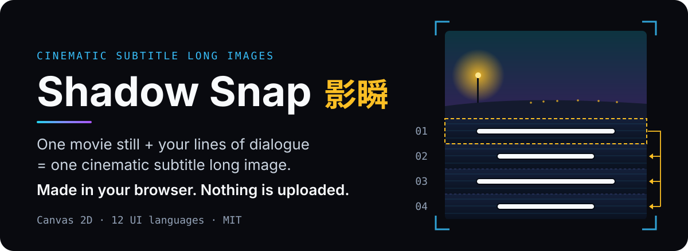
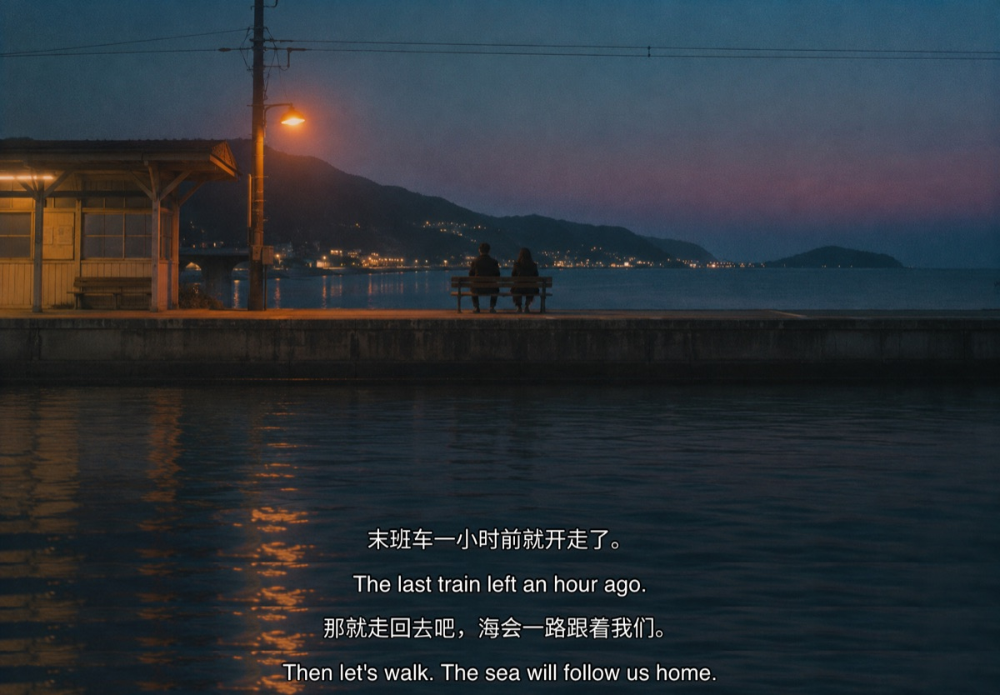
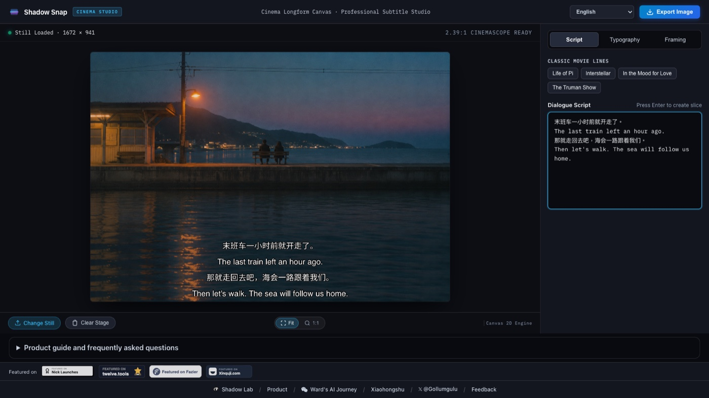

<p align="center">
  
</p>

<p align="center">
  <b>English</b> · <a href="./README.zh-CN.md">简体中文</a>
</p>

<p align="center">
  <a href="https://snap.shadow.wang/"><b>Open Shadow Snap →</b></a>
</p>

Shadow Snap is a free web tool that turns one movie still and your lines of dialogue into a single tall image, styled like a run of film subtitles. It runs entirely in your browser on an HTML5 Canvas: your image and your text are never uploaded, and there is no account to create.

## See it

<p align="center">
  
</p>

<p align="center"><sub>A real export: one still and four lines of dialogue. The still was generated by AI and the dialogue was written for this README.</sub></p>

<p align="center">
  
</p>

## How it works

1. You drop in a still and type your dialogue, one subtitle per line.
2. The first line is drawn across the bottom of the still.
3. For every extra line, Shadow Snap copies the bottom band of the still (as tall as the strip height you choose) and adds it underneath, then draws that line on it.
4. You export the result as one image.

The finished image is the still's height plus one strip for each line after the first. If an image is too large for the browser's canvas, Shadow Snap scales it down evenly: the limit is about 12 megapixels on phones and tablets and about 64 megapixels on desktop.

## Features

- **Four film presets**: Nolan White, Wong Kar-wai Gold, Tokyo Cyan and Minimal Mono set the text color, outline, strip height and font size in one click.
- **Classic movie lines** to start from: Life of Pi, Interstellar, In the Mood for Love and The Truman Show.
- **Fine control** over font, font size, strip height, side margins, text color, outline color and an optional watermark.
- **12 interface languages**: English, Simplified Chinese, Traditional Chinese, Japanese, Korean, Spanish, Portuguese, French, German, Russian, Indonesian and Arabic.
- **Phone friendly**: the canvas preview stays on screen while you edit. Export opens the share sheet, or shows a long-press save view in browsers that cannot share files, such as WeChat, Quark and UC.
- **Stills** in JPG, PNG or WebP, up to 30 MB each.

## Privacy

- Your still and your dialogue stay in the browser. Nothing is uploaded, and there is no sign-in.
- Fonts are served from the site itself, so the page makes no requests to third-party font services.
- The "Featured on" badges at the bottom of the page are loaded from the directory sites that issue them.
- The site counts page views with Vercel Web Analytics. It does not receive your image or your text.

## Run it locally

You need Node.js 22. There are no npm dependencies to install.

```bash
git clone https://github.com/WardLu/shadow-snap.git
cd shadow-snap
npm run preview   # http://127.0.0.1:3187
```

The preview serves only the public site files and listens only on `127.0.0.1`.

Other useful commands:

```bash
npm run seo:generate     # rebuild the language pages and sitemap after changing page text
npm run validate:static  # check that every page and asset reference is valid
npm run ci:check         # run the full local check list without recording a result
```

## Project layout

```text
├── index.html          # page shell, metadata and structured data (Chinese entry page)
├── <locale>/index.html # generated language pages; do not edit by hand
├── script.js           # canvas renderer, presets, export and interface logic
├── style.css           # studio design system
├── translations.mjs    # interface text for every language
├── seo-content.mjs     # page copy, FAQ and metadata for every language
├── public/             # brand assets and self-hosted fonts
├── scripts/            # preview, validation, font and release scripts
└── tests/              # SEO, release and CI contract tests
```

## Contributing

Bug reports and suggestions are welcome in [GitHub Issues](https://github.com/WardLu/shadow-snap/issues) or by email to [contact@wardlu.com](mailto:contact@wardlu.com). If you open a pull request, run `npm run ci:check` first. Page text lives in `translations.mjs` and `seo-content.mjs`; run `npm run seo:generate` instead of editing the generated language pages.

Production releases are made by the maintainer with a single release script. See [docs/release-process.md](docs/release-process.md). Version history is in [RELEASE_NOTES.md](RELEASE_NOTES.md).

## License

- **Code and documentation**: released under the [MIT License](LICENSE).
- **Fonts**: the bundled fonts in `public/fonts/` and the Chinese subset in `public/fonts-subset/` are under the SIL Open Font License 1.1. The license text is in each font folder under `public/fonts/` and in `public/fonts-subset/LICENSE`.
- **Brand assets**: not covered by the MIT License. The names 影瞬 and Shadow Snap, the logos, and the images in `public/brand_assets/` (including the WeChat Official Account QR code) may not be used in your own product without permission.

## Contact

Shadow Snap is made by Ward Lu at [Shadow Lab](https://shadow.wang). Interested in B2B products, AI product development, supply-chain digitalization, or the Shadow product line? Feel free to reach out:

- **Website** — [wardlu.com](https://wardlu.com)
- **X (Twitter)** — [@Gollumgulu](https://x.com/Gollumgulu)
- **WeChat Official Account** — search for 「Ward的AI产品实战」
- **Xiaohongshu (RED) / Weibo / Douyin** — same handle 「Ward的AI产品实战」 across platforms: [Xiaohongshu (RED)](https://xhslink.cn/m/4W1NWyRrxv5) · [Weibo](https://weibo.com/u/8344390431) · [Douyin](https://v.douyin.com/1y06PMohfoE/)
- **Email** — [contact@wardlu.com](mailto:contact@wardlu.com)
