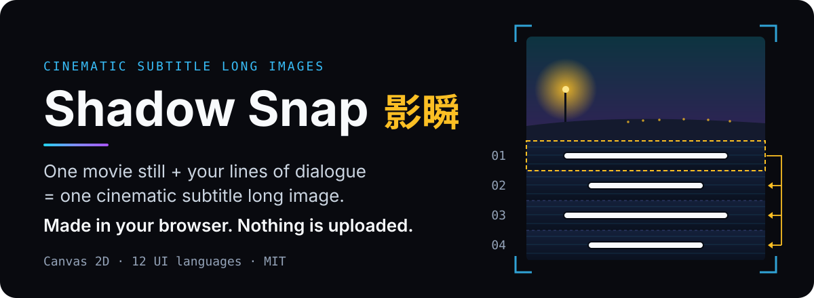
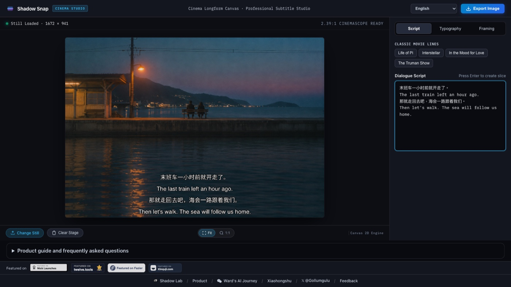

<p align="center">
  
</p>

<p align="center">
  <a href="./README.md">English</a> · <b>简体中文</b>
</p>

<p align="center">
  <a href="https://snap.shadow.wang/"><b>打开影瞬 →</b></a>
</p>

影瞬（Shadow Snap）是一个免费的网页工具：把一张电影剧照和你写的几行台词，拼成一张像连续电影字幕那样的竖向长图。整个过程都在你的浏览器里用 HTML5 Canvas 完成，图片和文字不会上传，也不需要注册账号。

## 效果

<p align="center">
  
</p>

<p align="center"><sub>这是一张实际导出的图：一张剧照，四行台词。剧照由 AI 生成，台词是为这份 README 原创的。</sub></p>

<p align="center">
  
</p>

## 工作原理

1. 放入一张剧照，输入台词，每行是一条字幕。
2. 第一行字幕写在剧照的底部。
3. 之后每多一行，影瞬就从剧照底部截一条画面带（高度就是你设置的条带高度），接在下面，再把这一行写上去。
4. 最后导出成一张图。

成图高度等于剧照高度，加上第一行之后每行一条条带的高度。如果图片超出了浏览器画布的上限，影瞬会等比缩小：手机和平板约 1200 万像素，电脑约 6400 万像素。

## 功能

- **4 套电影预设**：诺兰原声白、王家卫暖金、日系胶片青、极简纯黑白，一键设好字色、描边、条带高度和字号。
- **经典台词**一键填入：《少年派的奇幻漂流》《星际穿越》《花样年华》《楚门的世界》。
- **细节可调**：字体、字号、条带高度、两侧边距、文字颜色、描边颜色，以及可选的水印。
- **12 种界面语言**：英语、简体中文、繁体中文、日语、韩语、西班牙语、葡萄牙语、法语、德语、俄语、印尼语和阿拉伯语。
- **手机好用**：编辑时画布预览一直留在屏幕上。导出时会打开系统分享面板；在不支持分享文件的浏览器里（如微信、夸克、UC），会弹出长按保存的浮层。
- **剧照格式**：JPG、PNG 或 WebP，单张最大 30 MB。

## 隐私

- 剧照和台词只留在你的浏览器里，不上传，也不需要登录。
- 字体由网站自己提供，页面不会请求第三方字体服务。
- 页面底部 “Featured on” 的徽章图片，是从颁发它们的目录网站加载的。
- 网站用 Vercel Web Analytics 统计访问量，它收不到你的图片和文字。

## 本地运行

需要 Node.js 22，没有需要安装的 npm 依赖。

```bash
git clone https://github.com/WardLu/shadow-snap.git
cd shadow-snap
npm run preview   # http://127.0.0.1:3187
```

本地预览只提供公开的站点文件，并且只监听 `127.0.0.1`。

其他常用命令：

```bash
npm run seo:generate     # 改了页面文字后，重新生成各语言页面和 sitemap
npm run validate:static  # 检查所有页面和资源引用是否有效
npm run ci:check         # 运行完整的本地检查清单，但不写入记录
```

## 目录结构

```text
├── index.html          # 页面骨架、元数据和结构化数据（中文入口页）
├── <locale>/index.html # 生成的各语言页面，不要手改
├── script.js           # 画布渲染、预设、导出和界面逻辑
├── style.css           # 工作台设计系统
├── translations.mjs    # 各语言的界面文字
├── seo-content.mjs     # 各语言的页面正文、FAQ 和元数据
├── public/             # 品牌素材和自托管字体
├── scripts/            # 预览、校验、字体和发布脚本
└── tests/              # SEO、发布和 CI 的契约测试
```

## 参与贡献

问题反馈和建议，欢迎提交到 [GitHub Issues](https://github.com/WardLu/shadow-snap/issues)，或发邮件到 [contact@wardlu.com](mailto:contact@wardlu.com)。提交 PR 前，请先运行 `npm run ci:check`。页面文字在 `translations.mjs` 和 `seo-content.mjs` 里；改完运行 `npm run seo:generate`，不要直接改生成的语言页面。

生产发布由维护者通过唯一的发布脚本完成，见 [docs/release-process.md](docs/release-process.md)。版本历史见 [RELEASE_NOTES.zh-CN.md](RELEASE_NOTES.zh-CN.md)。

## 许可证

代码以 [MIT 许可证](LICENSE) 发布。`public/fonts/` 里的字体和 `public/fonts-subset/` 里的中文子集字体采用 SIL Open Font License 1.1；许可证原文在 `public/fonts/` 下的各个字体目录里，以及 `public/fonts-subset/LICENSE`。

MIT 许可证适用于本软件及其文档，但有一个例外：“影瞬”“Shadow Snap”的名称和 logo，以及 `public/brand_assets/` 里的品牌图片（含公众号二维码），不在 MIT 授权范围内。未经许可，请勿用于你自己的产品。

## 联系

影瞬由 [Shadow Lab](https://shadow.wang) 的 Ward Lu 制作。如果你对 B 端产品、AI 产品开发、供应链数字化或 Shadow 系列产品感兴趣，欢迎联系我：

- **个人网站**：[wardlu.com](https://wardlu.com)
- **X（Twitter）**：[@Gollumgulu](https://x.com/Gollumgulu)
- **微信公众号**：搜索「Ward的AI产品实战」
- **小红书 / 微博 / 抖音**：全网同名「Ward的AI产品实战」—— [小红书](https://xhslink.cn/m/4W1NWyRrxv5) · [微博](https://weibo.com/u/8344390431) · [抖音](https://v.douyin.com/1y06PMohfoE/)
- **邮箱**：[contact@wardlu.com](mailto:contact@wardlu.com)
